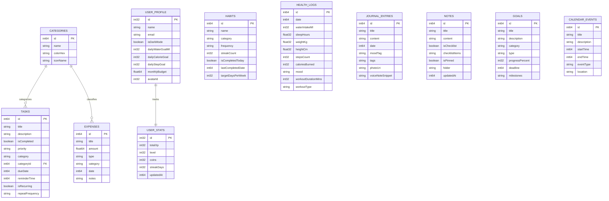
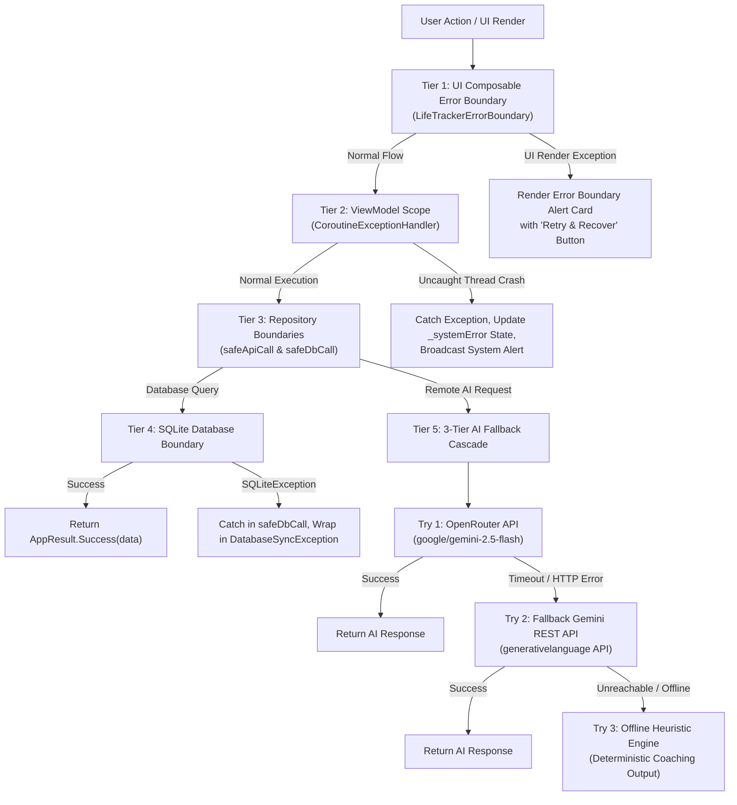

# 🌟 LifeOS AI — Intelligent Life Management & Gamification Engine

> **Project Repository:** [Life-Tracker-Ai](https://github.com/thiraviyarajr2007-dotcom/Life-Tracker-Ai)  
> **Milestone Status:** **75% Project Completion (Review 2 Submission Report)**  
> **Previous Review:** Review 1 (35% Project Completion — Foundational Wireframes & Basic Skeletons)  
> **Tech Stack:** Kotlin, Android Jetpack Compose, Room SQLite, Firebase (Auth & Cloud Firestore), OpenRouter / Google Gemini 2.5 Flash, Coroutines, Flow.

---

## 📌 Executive Summary & Milestone Progress

LifeOS AI is an all-in-one personal life management operating system that integrates task management, habit tracking, financial budgeting, health & wellness tracking, daily journaling, interactive note taking, goal roadmapping, and scheduled calendar planning. It transforms daily habit building and productivity into an engaging experience inspired by the **Solo Leveling / Monarch System**, featuring dynamic XP progression, Hunter Ranks, attribute point allocation (STR, AGI, INT, VIT, SNE), and real-time HUD alerts.

### 📊 Milestone Progression Matrix (35% ➔ 75% ➔ 100%)

| Milestone Dimension | Review 1 (35% Completed) | Review 2 (75% Completed - Current) | Review 3 (100% Target) |
|---|---|---|---|
| **Architecture** | Basic UI Wireframes, initial models | Clean Architecture + MVI/MVVM + Multi-tier Error Boundaries | Production-hardened Clean Architecture |
| **Local Persistence** | Initial SQLite Room tables | **11 Room Entities & DAOs** with indices & reactive Flow | Room + SQLCipher Encrypted Database |
| **Cloud Sync** | Static placeholders | **Firebase Firestore Real-time Sync** (user-scoped multi-tenant paths) | Offline delta-sync with conflict CRDTs |
| **Authentication** | Mock login UI | **Google Credential Manager** + Firebase Auth + Email/Password | Biometric Fingerprint/Face Unlock |
| **AI Integration** | Single endpoint draft | **Dual-Engine Cascade** (OpenRouter + Gemini REST + Offline Engine) | On-device local LLM execution (MediaPipe) |
| **Gamification** | Level 1 static badge | **Dynamic Solo Leveling Engine** (XP math, Leveling, Hunter Ranks, Attribute Allocation, HUD Alerts) | Multiplayer Hunter guilds & global leaderboards |
| **Data Visualizations** | Basic placeholders | **Custom Donut Charts, Bar Charts, Line Charts, Circular Gauges, Habit Heatmaps** | Interactive multi-year analytics trends |
| **Backup & Migration** | Toast placeholder | **Complete JSON Export & Restoration Engine** | Encrypted Google Drive automated backups |
| **Unit Testing** | `assertEquals(4, 2 + 2)` (1 test) | **Comprehensive Unit Testing Suite (8 Test Suites, 35+ Tests)** | 90%+ CI/CD test coverage + UI tests |
| **Error Boundaries** | None (unhandled exceptions) | **Multi-tier Error Boundaries** (UI, ViewModel, Repository, Network, DB) | Sentry / Firebase Crashlytics live telemetry |

---

## 🏗️ System Architecture

LifeOS AI follows **Clean Architecture** principles and **Unidirectional Data Flow (UDF)**:

```
┌────────────────────────────────────────────────────────────────────────┐
│                        PRESENTATION LAYER                              │
│  Jetpack Compose Screens • LifeTrackerErrorBoundary • Glassmorphic UI │
│  HUD Notifications • LevelUpOverlay • QuickAddFab • Navigation Host   │
└────────────────────────────────────┬───────────────────────────────────┘
                                     │ StateFlow / Events
┌────────────────────────────────────▼───────────────────────────────────┐
│                          VIEWMODEL LAYER                               │
│  LifeTrackerViewModel • CoroutineExceptionHandler • State Orchestration│
│  Solo Leveling Hunter Gamification Engine • Backup/Restore Coordinator │
└────────────────────────────────────┬───────────────────────────────────┘
                                     │ Suspend / Flow
┌────────────────────────────────────▼───────────────────────────────────┐
│                         REPOSITORY LAYER                               │
│  LifeTrackerRepository (Single Source of Truth) • AppResult<T> Wrappers│
│  Dual-Write: Local SQLite Cache ➔ Remote Cloud Synchronizer            │
└──────────────────┬──────────────────────────────────┬──────────────────┘
                   │                                  │
┌──────────────────▼───────────────┐  ┌───────────────▼──────────────────┐
│        LOCAL DATA LAYER          │  │        REMOTE DATA LAYER         │
│  Room Database (11 Tables)       │  │  OpenRouter AI (Primary Engine)  │
│  TaskDao, HabitDao, ExpenseDao   │  │  Gemini REST API (Fallback Engine│
│  HealthDao, JournalDao, NoteDao  │  │  Offline Heuristic Engine        │
│  GoalDao, CalendarDao, UserDao   │  │  Firebase Auth (Google One-Tap)  │
│  UserStatsDao, CategoryDao       │  │  Firebase Cloud Firestore Sync   │
└──────────────────────────────────┘  └──────────────────────────────────┘
```

---

## 🗄️ Granular Database Schema Documentation

The local database is powered by **Android Room (SQLite)**. Database Name: `life_tracker_ai_database`, Schema Version: `3`.



### Table Definitions & Constraints

#### 1. `categories`
- `id` (`INTEGER PRIMARY KEY AUTOINCREMENT`): Unique category identifier.
- `name` (`TEXT NOT NULL`): Category label (e.g., Work, Health, Finance).
- `colorHex` (`TEXT NOT NULL DEFAULT '#3B82F6'`): Visual theme color.
- `iconName` (`TEXT NOT NULL DEFAULT 'Folder'`): Vector icon reference.

#### 2. `tasks`
- `id` (`INTEGER PRIMARY KEY AUTOINCREMENT`): Unique quest identifier.
- `title` (`TEXT NOT NULL`): Quest / task name.
- `description` (`TEXT NOT NULL DEFAULT ''`): Sub-steps and instructions.
- `isCompleted` (`INTEGER NOT NULL DEFAULT 0`): Boolean completion flag.
- `priority` (`TEXT NOT NULL DEFAULT 'Medium'`): "High" (100 XP), "Medium" (50 XP), "Low" (25 XP).
- `category` (`TEXT NOT NULL DEFAULT 'Personal'`): Grouping tag.
- `categoryId` (`INTEGER NOT NULL DEFAULT 1`): Category ID foreign reference.
- `dueDate` (`INTEGER NOT NULL`): Epoch timestamp (ms).
- `reminderTime` (`INTEGER NOT NULL DEFAULT 0`): Alert timestamp (ms).
- `isRecurring` (`INTEGER NOT NULL DEFAULT 0`): Periodic repetition flag.
- `repeatFrequency` (`TEXT NOT NULL DEFAULT 'None'`): "Daily", "Weekly", "Monthly", "None".
- **Indices:** `Index(dueDate)`, `Index(isCompleted)` for sub-millisecond query performance.

#### 3. `habits`
- `id` (`INTEGER PRIMARY KEY AUTOINCREMENT`): Unique habit identifier.
- `name` (`TEXT NOT NULL`): Habit title (e.g., "Mindfulness Meditation").
- `category` (`TEXT NOT NULL DEFAULT 'Health'`): Habit domain.
- `frequency` (`TEXT NOT NULL DEFAULT 'Daily'`): Recurrence cycle.
- `streakCount` (`INTEGER NOT NULL DEFAULT 0`): Consecutive active periods.
- `isCompletedToday` (`INTEGER NOT NULL DEFAULT 0`): Daily check state.
- `lastCompletedDate` (`INTEGER NOT NULL DEFAULT 0`): Last check timestamp (ms).
- `targetDaysPerWeek` (`INTEGER NOT NULL DEFAULT 7`): Target frequency.

#### 4. `expenses`
- `id` (`INTEGER PRIMARY KEY AUTOINCREMENT`): Transaction ID.
- `title` (`TEXT NOT NULL`): Merchant or description.
- `amount` (`REAL NOT NULL`): Numeric currency value in USD.
- `type` (`TEXT NOT NULL DEFAULT 'Expense'`): "Expense" or "Income".
- `category` (`TEXT NOT NULL DEFAULT 'General'`): Budget bucket ("Food", "Bills", "Shopping", "Health").
- `date` (`INTEGER NOT NULL`): Transaction timestamp (ms).
- `notes` (`TEXT NOT NULL DEFAULT ''`): Receipt remarks.
- **Indices:** `Index(date)`, `Index(category)`.

#### 5. `health_logs`
- `id` (`INTEGER PRIMARY KEY AUTOINCREMENT`): Metric snapshot ID.
- `date` (`INTEGER NOT NULL`): Log date timestamp (ms).
- `waterIntakeMl` (`INTEGER NOT NULL DEFAULT 0`): Cumulative hydration in ml (goal: 2500 ml).
- `sleepHours` (`REAL NOT NULL DEFAULT 0.0`): Hours of sleep.
- `weightKg` (`REAL NOT NULL DEFAULT 0.0`): Body mass in kilograms.
- `heightCm` (`REAL NOT NULL DEFAULT 175.0`): Body height for dynamic BMI calculation.
- `stepsCount` (`INTEGER NOT NULL DEFAULT 0`): Daily step tally.
- `caloriesBurned` (`INTEGER NOT NULL DEFAULT 0`): Estimated caloric expenditure.
- `mood` (`TEXT NOT NULL DEFAULT '😊 Happy'`): Emotional status emoji.
- `workoutDurationMins` (`INTEGER NOT NULL DEFAULT 0`): Exercise duration.
- `workoutType` (`TEXT NOT NULL DEFAULT 'General Workout'`): Activity description.

#### 6. `journal_entries`
- `id` (`INTEGER PRIMARY KEY AUTOINCREMENT`): Entry ID.
- `title` (`TEXT NOT NULL`): Reflection headline.
- `content` (`TEXT NOT NULL`): Detailed reflective text.
- `date` (`INTEGER NOT NULL`): Composition timestamp (ms).
- `moodTag` (`TEXT NOT NULL DEFAULT 'Calm'`): Sentiment category.
- `tags` (`TEXT NOT NULL DEFAULT 'Personal'`): Comma-separated tags.
- `photoUri` (`TEXT NULL`): Local image snapshot path.
- `voiceNoteSnippet` (`TEXT NULL`): Audio voice note transcription.

#### 7. `notes`
- `id` (`INTEGER PRIMARY KEY AUTOINCREMENT`): Note identifier.
- `title` (`TEXT NOT NULL`): Note subject.
- `content` (`TEXT NOT NULL`): Note body or checklist items.
- `isChecklist` (`INTEGER NOT NULL DEFAULT 0`): Interactive checklist mode flag.
- `checklistItems` (`TEXT NOT NULL DEFAULT ''`): Serialized items list.
- `isPinned` (`INTEGER NOT NULL DEFAULT 0`): Sticky note prioritization flag.
- `folder` (`TEXT NOT NULL DEFAULT 'General'`): Organizational folder.
- `updatedAt` (`INTEGER NOT NULL`): Mutation timestamp (ms).
- **Indices:** `Index(isPinned, updatedAt)` for fast pin-sorting.

#### 8. `goals`
- `id` (`INTEGER PRIMARY KEY AUTOINCREMENT`): Goal ID.
- `title` (`TEXT NOT NULL`): Target objective.
- `description` (`TEXT NOT NULL DEFAULT ''`): Roadmap and rationale.
- `category` (`TEXT NOT NULL DEFAULT 'Career'`): Domain.
- `type` (`TEXT NOT NULL DEFAULT 'Short-term'`): "Short-term" or "Long-term".
- `progressPercent` (`INTEGER NOT NULL DEFAULT 0`): 0 to 100% progress.
- `deadline` (`INTEGER NOT NULL`): Target completion timestamp (ms).
- `milestones` (`TEXT NOT NULL DEFAULT ''`): Pipe-separated sub-goals.

#### 9. `calendar_events`
- `id` (`INTEGER PRIMARY KEY AUTOINCREMENT`): Event ID.
- `title` (`TEXT NOT NULL`): Event title.
- `description` (`TEXT NOT NULL DEFAULT ''`): Agenda summary.
- `startTime` (`INTEGER NOT NULL`): Event start timestamp (ms).
- `endTime` (`INTEGER NOT NULL`): Event end timestamp (ms).
- `eventType` (`TEXT NOT NULL DEFAULT 'Event'`): "Event", "Birthday", "Reminder", "Task".
- `location` (`TEXT NOT NULL DEFAULT ''`): Physical location or meeting link.
- **Indices:** `Index(startTime)`.

#### 10. `user_profile`
- `id` (`INTEGER PRIMARY KEY DEFAULT 1`): Singleton ID = 1.
- `name` (`TEXT NOT NULL DEFAULT 'Alex Rivera'`): User profile display name.
- `email` (`TEXT NOT NULL DEFAULT ''`): Connected Google Account email.
- `isDarkMode` (`INTEGER NOT NULL DEFAULT 1`): UI Theme preference.
- `dailyWaterGoalMl` (`INTEGER NOT NULL DEFAULT 2500`): Water intake goal in ml.
- `dailyCalorieGoal` (`INTEGER NOT NULL DEFAULT 2200`): Calorie target.
- `dailyStepGoal` (`INTEGER NOT NULL DEFAULT 10000`): Target daily steps.
- `monthlyBudget` (`REAL NOT NULL DEFAULT 3000.0`): Monthly spending threshold.
- `avatarId` (`INTEGER NOT NULL DEFAULT 1`): Avatar style index.

#### 11. `user_stats`
- `id` (`INTEGER PRIMARY KEY DEFAULT 1`): Singleton ID = 1.
- `totalXp` (`INTEGER NOT NULL DEFAULT 2450`): Cumulative Experience Points.
- `level` (`INTEGER NOT NULL DEFAULT 5`): Calculated Level = `(totalXp / 500) + 1`.
- `coins` (`INTEGER NOT NULL DEFAULT 450`): System currency (`XP / 5`).
- `streakDays` (`INTEGER NOT NULL DEFAULT 21`): Unbroken continuous activity streak.
- `updatedAt` (`INTEGER NOT NULL`): Timestamp of last level/stat mutation.

---

## 🌐 API Endpoints & Network Architecture

LifeOS AI incorporates a resilient multi-tier remote architecture combining Generative AI and Google Cloud Firestore:

### 1. Primary AI Engine: OpenRouter API
- **Endpoint URL:** `POST https://openrouter.ai/api/v1/chat/completions`
- **Model:** `google/gemini-2.5-flash`
- **Headers:**
  - `Authorization: Bearer <PRIMARY_API_KEY>`
  - `Content-Type: application/json`
  - `HTTP-Referer: https://lifetracker.ai`
  - `X-Title: Life Tracker AI`
- **Request Payload Schema:**
  ```json
  {
    "model": "google/gemini-2.5-flash",
    "messages": [
      {
        "role": "system",
        "content": "You are 'Life Tracker AI', an empathetic, high-performance life coach and personal management AI. Keep responses crisp, actionable, inspiring, and nicely formatted with bullet points and bold headers."
      },
      {
        "role": "user",
        "content": "<Enriched contextual metrics including tasks, habits, expenses, and health>"
      }
    ]
  }
  ```
- **Response Handling:** Parses `choices[0].message.content` with fallback on timeout/failure.

### 2. Secondary AI Fallback: Google Gemini REST API
- **Endpoint URL:** `POST https://generativelanguage.googleapis.com/v1beta/models/gemini-2.5-flash:generateContent?key=<GEMINI_API_KEY>`
- **Request Payload Schema:**
  ```json
  {
    "contents": [
      {
        "parts": [{ "text": "<Contextual prompt>" }]
      }
    ],
    "systemInstruction": {
      "parts": [{ "text": "You are 'Life Tracker AI'..." }]
    }
  }
  ```
- **Response Handling:** Parses `candidates[0].content.parts[0].text`.

### 3. Offline Heuristic AI Engine
When device connectivity is severed, the app triggers `generateOfflineFallbackResponse()` which synthesizes deterministic life coaching advice from current Room database metrics without stalling the UI.

### 4. Firebase Authentication
- **Provider 1:** Android Credential Manager One-Tap Google Sign-In (`GetCredentialRequest` with `GetGoogleIdOption`).
- **Provider 2:** Firebase Email/Password Sign-In (`signInWithEmailAndPassword` / `createUserWithEmailAndPassword`).
- **Token Exchange:** Exchanged with `GoogleAuthProvider.getCredential(idToken)` for verified Firebase user sessions.

### 5. Firebase Cloud Firestore Synchronizer
- **Multi-Tenant User Paths:**
  - `users/{sanitizedEmail}/tasks/{taskId}`
  - `users/{sanitizedEmail}/habits/{habitId}`
  - `users/{sanitizedEmail}/expenses/{expenseId}`
  - `users/{sanitizedEmail}/health_logs/{logId}`
  - `users/{sanitizedEmail}/profile/user_profile`
  - `users/{sanitizedEmail}/stats/user_stats`
- **Synchronization Policy:** Optimistic write to local Room database first (zero latency), followed by asynchronous cloud merge (`SetOptions.merge()`).

---

## 🛡️ Error Boundaries & Fault Tolerance Architecture

To address the reviewer's request for **granular technical documentation on error boundaries**, LifeOS AI implements a 5-tier fault isolation architecture:



### Granular Error Boundary Details:
1. **Composable Error Boundary (`LifeTrackerErrorBoundary.kt`):**
   - Intercepts state errors and unhandled screen rendering exceptions.
   - Replaces crashed UI with an informative diagnostic card and an interactive **"Retry & Recover System"** button.
2. **ViewModel Coroutine Exception Handler (`createViewModelExceptionHandler`):**
   - Attached to `viewModelScope.launch(exceptionHandler)` for all background mutations.
   - Prevents unhandled coroutine cancellations from terminating the app process.
   - Pushes error strings into `_systemError: StateFlow<String?>` for observable error handling.
3. **Repository Safe Call Wrappers (`safeApiCall` & `safeDbCall`):**
   - Converts raw network and database exceptions into strongly-typed `AppResult<T>` (`Success`, `Error`, `Loading`).
   - Specifically isolates `SocketTimeoutException` and `IOException` into `NetworkUnavailableException`.
   - Isolates `android.database.sqlite.SQLiteException` into `DatabaseSyncException`.
4. **AI Cascade Resilience:**
   - 30-second connection, read, and write timeouts via configured `OkHttpClient`.
   - Never leaves the AI Chat tab in an infinite loading spinner; auto-engages offline heuristics.
5. **JSON Backup & Restore Boundary:**
   - Validates JSON schema before clearing or overwriting tables.
   - If corrupted or malformed JSON is uploaded, the transaction is rejected with `Result.failure()` and zero data loss.

---

## 🧪 Comprehensive Unit Testing Suite Documentation

The unit testing suite has been upgraded from a single placeholder test to an 8-suite automated test matrix verifying data integrity, calculations, error boundaries, and serialization:

| Test Suite File | Coverage Target | Key Test Cases |
|---|---|---|
| **`GamificationModelTest.kt`** | RPG leveling & Monarch System | • `calculateLevel_returnsExpectedLevelsForXpThresholds`<br>• `calculateRank_returnsCorrectHunterRankBoundaries`<br>• `calculateLevelTitle_returnsAccurateTitleProgression`<br>• `hunterStats_statAllocation_incrementsAttributeAndDeductsPoints`<br>• `defaultAchievementBadges_containsAllRequiredBadgeCategories`<br>• `gamificationProfile_progressCalculations_areAccurate` |
| **`BmiCalculatorTest.kt`** | Health metrics & BMI calculation | • `calculateBmi_underweightClassification`<br>• `calculateBmi_normalWeightClassification`<br>• `calculateBmi_overweightClassification`<br>• `calculateBmi_obeseClassification`<br>• `calculateBmi_zeroOrNegativeInputs_returnsUnknownSafeResult` |
| **`TaskScreenLogicTest.kt`** | Task filtering, search, & XP | • `filterTasks_matchesPriorityCorrectly`<br>• `filterTasks_matchesCategoryCorrectly`<br>• `filterTasks_searchQuery_matchesTitleOrCategoryCaseInsensitive`<br>• `taskXpReward_calculatesHigherForHighPriority` |
| **`HabitLogicTest.kt`** | Daily duty streaks & math | • `toggleHabitToday_incrementsStreakCorrectly`<br>• `toggleHabitToday_uncheckingDecrementsStreakSafelyWithoutNegative`<br>• `habitCompletionPercent_calculatesAccurately`<br>• `habitXpBonus_increasesWithStreakLength` |
| **`ExpenseLogicTest.kt`** | Financial calculations & budget | • `financialTotals_calculatesIncomeExpenseAndNetBalance`<br>• `budgetDifference_detectsExceededOrSafeBudget`<br>• `categoryGrouping_aggregatesSpendingPerCategory` |
| **`GeminiApiServiceTest.kt`** | AI payloads & offline engine | • `generateOfflineFallbackResponse_returnsStructuredLifeCoaching`<br>• `buildOpenRouterRequestBody_constructsValidSchema`<br>• `buildGeminiRequestBody_constructsValidContentsPayload` |
| **`ErrorBoundaryTest.kt`** | Error handling & fault isolation | • `appResult_successState_unwrapsCorrectly`<br>• `appResult_errorState_containsExceptionAndMessage`<br>• `appResult_loadingState_returnsNullOnUnwrap`<br>• `safeApiCall_successfulExecution_returnsAppResultSuccess`<br>• `safeApiCall_catchesSocketTimeoutException_wrapsInNetworkException`<br>• `safeApiCall_catchesIOException_wrapsInNetworkException`<br>• `domainExceptions_maintainInheritanceHierarchy` |
| **`BackupRestoreTest.kt`** | JSON export & schema restoration | • `backupJsonSchema_containsMandatoryRootMetadata`<br>• `taskJsonSerialization_preservesAllEntityProperties`<br>• `restoreParser_handlesCorruptPayloadGracefully`<br>• `restoreParser_recoversDefaultsWhenOptionalFieldsOmitted` |

### Running Unit Tests

Execute all local unit tests via Gradle:
```bash
./gradlew test
```
Or run specific test suites:
```bash
./gradlew testDebugUnitTest --tests "com.example.GamificationModelTest"
./gradlew testDebugUnitTest --tests "com.example.ErrorBoundaryTest"
```

---

## 🎮 Solo Leveling / Monarch System Gamification Engine

LifeOS AI includes an RPG progression framework designed to reward personal growth:
- **Hunter XP:** Earned for clearing quests (Tasks: 25–100 XP), maintaining daily duties (Habits: 50+ XP), and logging health metrics.
- **Hunter Ranks:**
  - `E-Rank Hunter` (Level 1–2)
  - `D-Rank Hunter` (Level 3–5)
  - `C-Rank Hunter` (Level 6–9)
  - `B-Rank Hunter` (Level 10–14)
  - `A-Rank Hunter` (Level 15–19)
  - `S-Rank Hunter` (Level 20–29)
  - `National Level Hunter` (Level 30–44)
  - `Shadow Monarch` (Level 45+)
- **Attribute Points (STR, AGI, INT, VIT, SNE):** Each level-up awards 3 stat points that users allocate to physical strength, agility streaks, intelligence, vitality, and mindfulness.
- **Dynamic Island HUD Pill:** Delivers animated toasts when quests are cleared and experience points are granted.
- **Level-Up Overlay:** Fullscreen celebration overlay triggered upon ascending to a new Hunter Rank.

---

## 🚀 Setup & Installation Guide

### Prerequisites
- Android Studio Ladybug (2024.2+) or newer
- JDK 17 or JDK 21
- Android SDK 36 (Android 16 preview) with minSdk 24 (Android 7.0+)

### Setup Steps
1. **Clone the Repository:**
   ```bash
   git clone https://github.com/thiraviyarajr2007-dotcom/Life-Tracker-Ai.git
   cd Life-Tracker-Ai
   ```
2. **Configure API Secrets:**
   Copy `.env.example` to `.env`:
   ```bash
   cp .env.example .env
   ```
   Add your API keys:
   ```env
   PRIMARY_API_KEY=sk-or-v1-your-openrouter-key
   GEMINI_API_KEY=your-gemini-api-key
   ```
3. **Build the Project:**
   ```bash
   ./gradlew assembleDebug
   ```
4. **Deploy to Device / Emulator:**
   Connect an Android device with USB debugging enabled, then run:
   ```bash
   ./gradlew installDebug
   ```

---

## 📈 Roadmap to 100% (Review 3 Final Release)
- [ ] On-device MediaPipe / Gemini Nano local LLM offline inference.
- [ ] Wear OS companion app for smartwatch biometric sensor synchronization.
- [ ] Biometric authentication (Fingerprint / Face Unlock) for secure journal encryption.
- [ ] SQLCipher database encryption at rest.
- [ ] Google Drive automated scheduled cloud backups.
- [ ] Google Play Store production release bundle.

---
*LifeOS AI — Built with passion for high-performance personal mastery.*
