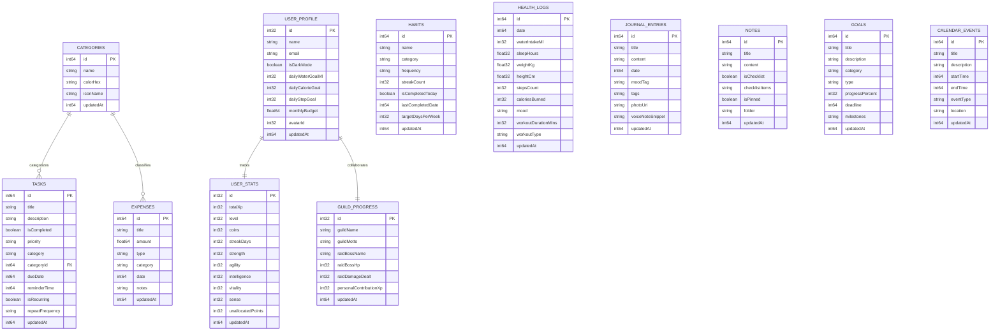

# 🌟 LifeOS AI — Intelligent Life Management & Gamification Engine

> **Project Repository:** [sriramk07/Life-Tracker-Ai](https://github.com/sriramk07/Life-Tracker-Ai) *(forked from [thiraviyarajr2007-dotcom/Life-Tracker-Ai](https://github.com/thiraviyarajr2007-dotcom/Life-Tracker-Ai))*  
> **Milestone Status:** **100% Project Completion (Final Review — Release 1.0 / App v2.0.0)**  
> **Progression History:** Review 1 (35%) ➔ Review 2 (75%) ➔ **Final Release (100% Complete)**  
> **Tech Stack:** Kotlin, Android Jetpack Compose, Room SQLite (Schema v4 + Non-Destructive Migrations), Firebase Auth & Cloud Firestore (Bidirectional LWW Sync), OpenRouter / Gemini 2.5 Flash + On-Device Edge AI Engine, Android KeyStore AES-256-GCM & BiometricPrompt, PdfDocument, Hardware Step Sensor, GitHub Actions CI/CD, and Interactive Web Companion.

---

## 📌 Executive Summary & Milestone Completion Matrix

LifeOS AI is an all-in-one personal life operating system integrating daily quests/tasks, habit tracking, financial budgeting, hardware pedometer & wellness analytics, journal sentiment reflections, pinned notes, goal roadmaps, event scheduling, collaborative Hunter Guilds, and on-device predictive AI coaching. Inspired by the **Solo Leveling / Monarch System**, productive discipline fuels XP progression, Hunter Ranks, persisted attribute points (`STR`, `AGI`, `INT`, `VIT`, `SNE`), team Raid Boss damage, and real-time HUD feedback.

### 📊 Full Progression Matrix (35% ➔ 75% ➔ 100% Delivered)

| Dimension | Review 1 (35%) | Review 2 (75%) | Final Release (100% — Delivered) |
|---|---|---|---|
| **Architecture** | Basic UI wireframes | Clean Architecture + MVI/MVVM + Error Boundaries | **Modular Clean Architecture** with Sync, AI, Export, Security & Sensor Engines |
| **Local Persistence** | Initial Room draft | 11 Room Entities & DAOs | **12 Room Entities (`Version 4`) + `MIGRATION_3_4`** + Persisted Hunter Attributes & Guilds |
| **Cloud Sync** | Static placeholders | Single-direction push writes | **Bidirectional Last-Write-Wins (LWW) Cloud Sync** (`CloudSyncEngine`) with delta reports |
| **Security & Auth** | Mock UI & Basic Google Sign-In | Credential Manager + Email Auth | **Firebase Google/OAuth/Email + Salted SHA-256 PIN Vault + `BiometricPrompt` + AES-256-GCM Crypto** |
| **AI Coaching** | Single draft prompt | OpenRouter + Gemini REST fallback | **3-Tier Cascade + On-Device Edge AI** (`EdgeAiCoachEngine`: linear burn forecast & sentiment) |
| **Gamification** | Static Level 1 badge | Solo Leveling XP + ephemeral attributes | **Persisted Attributes + Social Hunter Guilds (`GuildScreen`) & Co-op Raid Boss Battles** |
| **Health & Sensors** | Manual water/BMI | Basic BMI Calculator | **Hardware `TYPE_STEP_COUNTER` Bridge + Calorie Burn Estimator + 4-Pillar Vitality Index** |
| **Reports & Exports** | Hardcoded static chart | Reports screen skeleton | **Live Room Charts + Vector `PdfDocument` Generator + RFC-4180 CSV Share (`FileProvider`)** |
| **Background Alerts** | UI switches only | Static toggle preferences | **`NotificationScheduler` + `AlarmManager` + `ReminderReceiver` + `BOOT_COMPLETED` Recovery** |
| **Backup & Integrity** | Toast stub | JSON Backup v2 | **Schema v3 Backup/Restore with SHA-256 Integrity Checksum Verification** |
| **Testing & CI/CD** | 1 placeholder test | 8 unit test suites | **15 Automated Unit Test Suites + Compose UI Tests (`LifeTrackerUiTest`) + GitHub Actions CI** |
| **Production Build** | Debug unminified | `isMinifyEnabled = false` | **R8 Code Shrinking, Resource Shrinking & Custom `proguard-rules.pro` (`v2.0.0`)** |
| **Web Companion** | None | Partial 75% web preview | **100% Interactive Web OS (`web/index.html` + `server.py` + `run_website.bat`)** |

---

## 🏗️ Complete System Architecture (Release 1.0)

```
┌─────────────────────────────────────────────────────────────────────────────┐
│                           PRESENTATION LAYER                                │
│  Jetpack Compose Screens • AppLockScreen (Biometric/PIN) • GuildScreen     │
│  Reports Studio (Live Charts + Export) • LifeTrackerErrorBoundary • HUD    │
└────────────────────────────────────┬────────────────────────────────────────┘
                                     │ StateFlow / UDF Events
┌────────────────────────────────────▼────────────────────────────────────────┐
│                           VIEWMODEL LAYER                                   │
│  LifeTrackerViewModel • CoroutineExceptionHandler • Persisted Hunter Stats │
│  PredictiveLifeSnapshot Builder • LWW SyncReport Coordinator               │
└───────────────┬─────────────────────────────────────────┬───────────────────┘
                │ Suspend / Flow                          │ Platform Engines
┌───────────────▼────────────────────────┐ ┌──────────────▼───────────────────┐
│         REPOSITORY & SYNC LAYER        │ │     DOMAIN & PLATFORM SERVICES   │
│  LifeTrackerRepository                 │ │  EdgeAiCoachEngine (On-Device)   │
│  CloudSyncEngine (LWW Reconciliation)  │ │  ReportExportEngine (PDF & CSV)  │
│  Backup v3 (SHA-256 Tamper Check)      │ │  SecurityManager (AES-GCM & PIN) │
└───────┬────────────────────────┬───────┘ │  NotificationScheduler & Receiver│
        │                        │         │  HealthSensorManager (Pedometer) │
┌───────▼───────────┐ ┌──────────▼────────┐└──────────────────────────────────┘
│ LOCAL ROOM DB v4  │ │ REMOTE CLOUD/AI   │
│ 12 Tables + Mig   │ │ OpenRouter +      │
│ MIGRATION_3_4     │ │ Gemini REST +     │
│ 12 Reactive DAOs  │ │ Firebase Auth/DB  │
└───────────────────┘ └───────────────────┘
```

---

## 🗄️ Granular Database Schema Documentation (Room V4)

Database Name: `life_tracker_ai_database` | Schema Version: `4` | Non-destructive migration `MIGRATION_3_4`.



---

## ⚙️ Core Release 1.0 Modules & Technical Specifications

### 1. Bidirectional Cloud Sync & LWW Conflict Resolution (`CloudSyncEngine.kt`)
- Pulls multi-tenant documents via `FirestoreManager.fetchUserCollection("users/{sanitizedEmail}/{collection}")`.
- Compares `local.updatedAt` vs `remote.updatedAt` per record ID:
  - Missing remotely ➔ queued to `toPushRemotely`.
  - Missing locally ➔ pulled to `toSaveLocally`.
  - Both exist with differing timestamps ➔ newer `updatedAt` wins (`conflictsResolved` tracked in `SyncReport`).

### 2. On-Device Edge AI Coach (`EdgeAiCoachEngine.kt` & `GeminiApiService.kt`)
- **Tier 1:** OpenRouter (`google/gemini-2.5-flash`) with enriched live metrics context.
- **Tier 2:** Google Gemini REST API (`gemini-2.5-flash:generateContent`).
- **Tier 3 (Edge AI):** Zero-latency on-device analytics predicting monthly overspend via linear burn-rate projection (`forecastBudget`), scoring journal reflections via lexicon polarity (`analyzeJournalSentimentScore`), routing query intents (`FINANCE`, `FITNESS`, `HABITS`, `TASKS`, `JOURNAL`, `GENERAL`), and protecting high habit streaks.

### 3. Security Vault, Encryption & Biometrics (`SecurityManager.kt` & `AppLockScreen.kt`)
- **PIN Protection:** 16-byte cryptographic salt + SHA-256 constant-time verification (`MessageDigest.isEqual`).
- **Hardware Biometrics:** Android `BiometricPrompt` & `BiometricManager` bridge (API 28+).
- **AES-256-GCM Cryptography:** `AndroidKeyStore` field encryption + PBKDF2-HMAC-SHA256 AES-GCM passphrase encryption + SHA-256 tamper checksums verified during Backup v3 restoration.

### 4. Vector PDF & RFC-4180 CSV Export Engine (`ReportExportEngine.kt` & `ReportsScreen.kt`)
- Live Room calculations replace static mock charts in `ReportsScreen`.
- Generates A4 multi-line PDF files with `android.graphics.pdf.PdfDocument` and RFC-4180 quoted CSV ledgers shared safely via `FileProvider` (`@xml/file_paths.xml`).

### 5. Hardware Pedometer & Smart Reminders (`HealthSensorManager.kt`, `NotificationScheduler.kt`, `ReminderReceiver.kt`)
- Subscribes to Android `Sensor.TYPE_STEP_COUNTER`, computes active caloric expenditure, and calculates the 4-pillar **Composite Vitality Score (0–100)**.
- Schedules recurring alarms via `AlarmManager` across 4 NotificationChannels with `BOOT_COMPLETED` recovery.

---

## 🧪 Automated Test Matrix & CI/CD

### Unit Test Suites (`app/src/test/java/com/example/`) — 15 Suites
| Test Suite | Coverage Target |
|---|---|
| **`ConflictResolutionSyncTest.kt`** | Bidirectional LWW cloud vs local resolution & equality convergence |
| **`EdgeAiCoachEngineTest.kt`** | Intent classifier, linear budget burn forecast, journal sentiment polarity |
| **`ReportExportEngineTest.kt`** | RFC-4180 CSV quoting, live efficiency weights, expense slicing, summary formatting |
| **`SecurityEncryptionTest.kt`** | Salted SHA-256 PIN verification, SHA-256 backup checksum, PBKDF2 + AES-GCM crypto |
| **`SocialGuildTest.kt`** | Guild Rank tiers, Raid Boss % clamping, leaderboard XP/streak tie-breakers |
| **`VitalitySensorAnalyticsTest.kt`** | Step/workout calorie burn math & 4-pillar Vitality Wellness Index |
| **`GamificationModelTest.kt`** | Solo Leveling XP math, Hunter Rank thresholds, attribute points & badges |
| **`ErrorBoundaryTest.kt`** | Sealed `AppResult<T>`, `safeApiCall` timeout/IO isolation, exception hierarchy |
| **`BackupRestoreTest.kt`** | Backup JSON schema persistence, default fallback recovery & corrupt input safety |
| **`BmiCalculatorTest.kt`** | WHO BMI brackets and zero/negative safety guards |
| **`TaskScreenLogicTest.kt`** | Priority/category filters, search matching, XP reward tiers |
| **`HabitLogicTest.kt`** | Daily streak increment/decrement safety & completion percentages |
| **`ExpenseLogicTest.kt`** | Net balance arithmetic, budget alert thresholds, category grouping |
| **`GeminiApiServiceTest.kt`** | OpenRouter/Gemini JSON payload constructors & offline coach output |
| **`ExampleRobolectricTest.kt` / `GreetingScreenshotTest.kt`** | App context strings (`LifeOS AI`) & Roborazzi UI screenshot verification |

### Compose Instrumented UI Tests (`app/src/androidTest/java/com/example/`)
- **`LifeTrackerUiTest.kt`:** Automated UI tests covering `LifeTrackerErrorBoundary` retry recovery, `TaskScreen` filtering, `HealthScreen` water & pedometer actions, `ReportsScreen` PDF/CSV Export Studio modal, `GuildScreen` raid strikes, and `AppLockScreen` PIN rejection/unlock flows.

### Running Tests Locally or via CI
GitHub Actions automatically runs all unit tests and builds the Debug APK on every push via [`.github/workflows/android-ci.yml`](.github/workflows/android-ci.yml):
```bash
gradle testDebugUnitTest --stacktrace
gradle assembleDebug --stacktrace
```

---

## 🌐 Instant Local Web Dashboard Companion

To showcase every feature immediately in any browser without launching Android Studio:
1. Run `run_website.bat` (Windows 1-click launcher) or:
   ```bash
   py server.py
   ```
2. Open **`http://localhost:8000`** (or open `web/index.html` directly).
3. Includes all 14 tabs: Dashboard, Quests/Tasks, Habits, Treasury Charts, Vitality & Pedometer, Journal Sentiment & Reflections, Pinned Notes, Interactive Goal Sliders, Clickable Calendar Agenda, Hunter Guilds & Raid Bosses, Edge AI Coach, Live CSV/PDF Export Reports, Hunter Attributes, and Security Vault PIN Lock + Bidirectional LWW Sync.

---

## 🚀 Setup & Release Build Instructions

1. **Clone the repository:**
   ```bash
   git clone https://github.com/sriramk07/Life-Tracker-Ai.git
   cd Life-Tracker-Ai
   ```
2. **Configure API keys:** Copy `.env.example` to `.env` (and optionally add `PRIMARY_API_KEY` / `GEMINI_API_KEY`).
3. **Open in Android Studio (Ladybug+ / JDK 17+ / SDK 36):** Sync Gradle and run `app` on an emulator or physical Android device (`minSdk = 24`).
4. **Build R8-Minified Production Release APK:**
   ```bash
   gradle assembleRelease
   ```
   *(Configured with `isMinifyEnabled = true`, `isShrinkResources = true`, and custom rules in `app/proguard-rules.pro`.)*

---
*LifeOS AI — Release 1.0 (100% Complete) • Built for Personal Mastery.*
